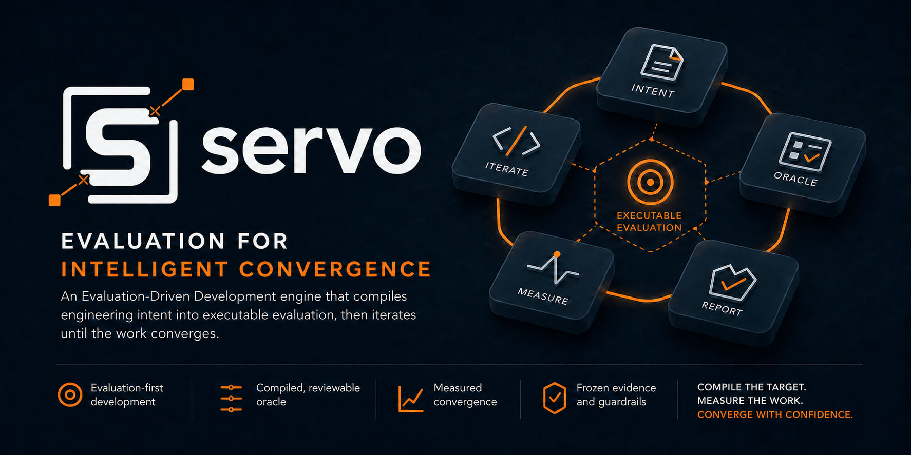

> A Claude Code and Codex evaluation layer that turns engineering intent into executable evidence.

**servo** (noun): a feedback system that measures an outcome against a target
and adjusts until they converge.

## Why Servo

AI agents can produce code faster than teams can define and repeatedly judge
“done.” Projects end up rebuilding the same machinery: acceptance checks,
scoring, retry loops, budget limits, and evidence collection.

Servo makes the target executable first. It compiles approved intent and the
signals already present in a project into evaluation that humans, CI, or agents
can run consistently. Autonomous execution is optional; the evaluation remains
the source of truth.

## What it does

Goal or criteria → reviewed evaluation → `oracle.sh` → guarded execution → evidence

- Turn a goal into reviewed, human-approved evaluation criteria.
- Decide whether work is suitable for unattended evaluation.
- Compile project signals and acceptance criteria into an executable oracle.
- Author frozen deterministic and model-judged evaluation components.
- Run quality gates or guarded implementation loops.
- Schedule read-only discovery and oracle-gated follow-up work.

## Principles Servo encodes

- **Evaluation before execution.** Define and approve success before optimizing
  an implementation toward it.
- **Humans own intent.** Servo may propose criteria, but it never silently turns
  generated criteria into product truth.
- **Project-owned evidence.** The project controls its `oracle.sh`, durable
  evaluation artifacts, and evaluation policy.
- **Guardrails are executable.** Missing prerequisites, budget exhaustion, and
  inconclusive evidence produce explicit outcomes instead of optimistic passes.
- **Runtimes are interchangeable.** Humans, CI, Claude Code, Codex, GitHub
  Copilot CLI, or Servo’s optional loop can consume the same evaluation.

See the [product vision](https://github.com/ramboz/servo/blob/main/docs/product-vision.md)
for the full product framing and
[architecture](https://github.com/ramboz/servo/blob/main/docs/architecture.md)
for implementation contracts.

## Start here

Install the plugin for your host, then open a fresh session in the project you
want to evaluate.

### Install

**Claude Code plugin**

```text
/plugin marketplace add ramboz/servo
/plugin install servo@servo
```

**Codex plugin**

```bash
codex plugin marketplace add ramboz/servo
codex plugin add servo@servo
```

**GitHub Copilot CLI plugin**

```bash
copilot plugin marketplace add ramboz/servo
copilot plugin install servo@servo
```

Or install the committed package straight from the repository subdirectory:

```bash
copilot plugin install ramboz/servo:hosts/copilot
```

Copilot scaffolding and quality gates work without Claude or Jig. Native autonomy
is **unavailable**: `--host copilot` refuses before dispatch; the minimum-30 soft
AI-credit cap cannot replace hard USD/context safeguards ([ADR-0043](https://github.com/ramboz/servo/blob/main/docs/decisions/adr-0043-copilot-capability-boundaries.md)).
Claude goal/background/Routine behavior is unchanged. Copilot's `agentStop` is
advisory; per-turn continuation is unproved.

## Extension points

> Bring your own criteria and signals; Servo provides the evaluation harness.

- Add project-specific `score_<name>` components to the generated oracle.
- Drive evaluation from a human workflow, CI, or another execution runtime.
- Use [Jig](https://github.com/ramboz/jig) as an optional upstream workflow;
  neither plugin requires the other.

## Verifying a host install

Claude, Codex, and Copilot packages are generated and verified independently;
one host’s successful install does not prove another. Maintainer verification
and release-archive procedures live in
[CONTRIBUTING.md](https://github.com/ramboz/servo/blob/main/CONTRIBUTING.md).

### From source (contributors)

Use the local host packages and the CI-equivalent gate documented in
[CONTRIBUTING.md](https://github.com/ramboz/servo/blob/main/CONTRIBUTING.md).

## Getting started

After installing, open the target project in a fresh session and say:

> Set up Servo for this project

That invokes `/servo:scaffold-init`, which inspects the project and creates a
reviewable `oracle.sh`, `.servo/install.json`, and refinement notes.

## Native Copilot evaluation

Native authoring is explicit (`from-goal --backend copilot --model <id>`) and
produces proposed criteria, not automatic approval. New frozen native judges
require `--transport copilot`, a non-auto model and deliberate
`--decoding-mode native-default` consent with an exact CLI version. Numeric
decoding controls and native score injection are rejected; existing approved
API/Claude configurations are not migrated automatically.

Generic native evals grade real, component-relative output files supplied by the
producer; file-v1 is constraint-free, not a system command runner. Native judges
have unknown USD cost: standalone attended scoring works, but registered
unpriced components refuse USD-bounded loops/heartbeats. See the
[current decisions](https://github.com/ramboz/servo/blob/main/docs/decisions/README.md).

## Required assertions beside quality (explicit opt-in)

Existing scalar projects keep gate JSON v1 and their current threshold behavior.
Projects can now generate, review, approve and explicitly install required
`command` / `generated_artifact_command` checks with
`oracle_overlay.py install … --enable-required`. A required contradiction vetoes
even a perfect composite, zero component weight, or `THRESHOLD=0`; unavailable
or invalid evidence refuses with exit 2. Enabled JSON v2 preserves the overall
gate and run/digest-bound component evidence. A component's pass alone is never
completion authority. See the
[installed walkthrough and carrier](https://github.com/ramboz/servo/blob/main/skills/spec-oracle/examples/required-policy.md).
Supported Claude-backed loop/goal, oracle-hook advice and heartbeat reports
preserve the original overall payload and exact gate path/hash. Inspect required
IDs/reasons, repair implementation and rerun; on unavailable evidence repair
acquisition/bindings instead. Policy changes require explicit reviewed reapproval.
Existing customized hooks need explicit migration, never silent replacement.
Diagnostic plateau is not completion; source provenance is not served-build
attestation. Native Copilot unattended autonomy remains unsupported.

## Repository structure (for contributors)

Canonical source at the repository root generates committed, drift-guarded
packages under `hosts/claude`, `hosts/codex`, and `hosts/copilot`. See the
[architecture](https://github.com/ramboz/servo/blob/main/docs/architecture.md)
for contracts and package topology.

## Contributing

Servo uses squash merges, conventional PR titles, a CI-equivalent local gate,
and release-please. See
[CONTRIBUTING.md](https://github.com/ramboz/servo/blob/main/CONTRIBUTING.md).

## Status

The project-owned evaluation workflow is available for Claude Code, Codex and
GitHub Copilot CLI; native Copilot autonomy remains unavailable. Live capability status and
sequencing are maintained in the
[status board](https://github.com/ramboz/servo/blob/main/docs/specs/README.md).

## License

[MIT](https://github.com/ramboz/servo/blob/main/LICENSE)
